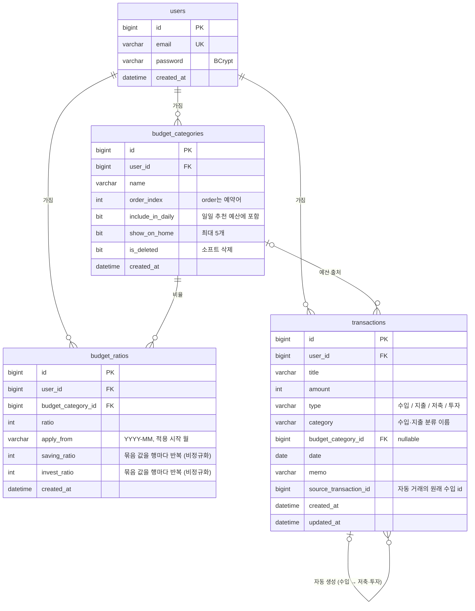

# Moa

월 수입을 비율로 나누어 예산을 관리하는 가계부 앱입니다.
수입을 입력하면 설정한 비율대로 카테고리별 예산이 계산되고, 저축·투자는 자동으로 분리됩니다.

## 현재 상태 (2026-11)

| 구성 | 상태                                                                                                                        |
| ---- | --------------------------------------------------------------------------------------------------------------------------- |
| 서버 | Spring Boot + MySQL REST API **18개 구현 완료** (인증, 카테고리, 예산 비율, 거래, 홈, 통계)                                 |
| 배포 | 2026-11-18 Railway에 서버 + MySQL 배포, HTTPS 확인. **현재는 중지** (설정·환경변수·DB 볼륨은 남아 있어 시연할 때 다시 띄움) |
| 앱   | 기본은 **로컬 모드**(폰 안 DB, 로그인 없음). 빌드 옵션으로 **서버 모드**(이 서버와 통신) 선택 가능                          |

### 왜 로컬 모드로 바꿨나

1. **처음에는 Firebase**로 만들었습니다. 기기 간 동기화만 필요했다면 Firebase로도 충분했지만, 요청이 어떻게 인증되고 규칙이 어디서 검증되며 데이터가 어떻게 저장되는지 직접 설계하고 싶어서 Spring Boot 서버를 만들었습니다.
2. 서버를 Railway에 배포해 실제로 동작하는 것까지 확인했습니다.
3. 하지만 실제로 이 앱을 쓰는 사람은 저 혼자이고, 서버를 계속 켜 두려면 매달 비용이 듭니다(체험 계정, 결제 수단 없음). 혼자 쓰는 가계부에는 로그인과 서버가 꼭 필요하지 않았습니다.
4. 그래서 **저장소를 인터페이스로 분리**하고 구현을 두 개 두었습니다.
   - 로컬 구현(기본): drift(SQLite). 서버의 계산 규칙(비율 합계 100, 홈 표시 최대 5개, 수입 시 저축·투자 자동 생성 등)을 Dart로 옮김. 데이터는 JSON 백업 파일로 내보내기/가져오기
   - 서버 구현: 기존 HTTP 코드 그대로. `--dart-define=MODE=remote`로 빌드하면 사용

서버 코드는 지우지 않았습니다. 로컬 구현의 설계도이자, 여러 기기·여러 사용자가 필요해지면 다시 쓰는 경로입니다.

진행 상황은 [TODO.md](./TODO.md) 참고.

## 기술 스택

| 영역 | 사용 기술                                     |
| ---- | --------------------------------------------- |
| 앱   | Flutter (iOS / Android), drift(로컬 모드)     |
| 서버 | Spring Boot 4.1, Java 21, Gradle (Kotlin DSL) |
| 인증 | Spring Security, JWT (jjwt 0.12), BCrypt      |
| DB   | MySQL 8.4, Spring Data JPA (Hibernate)        |
| 배포 | Docker, Railway (배포 후 현재 중지)           |

## 폴더 구조

```
moa/
├── flutter/   # 모바일 앱 (package: com.binsu.moa)
├── server/    # Spring Boot 서버 (package: com.binchae.moa)
└── TODO.md    # 진행 체크리스트
```

서버 패키지 구성 (`server/src/main/java/com/binchae/moa/`):

```
config/      SecurityConfig, JwtProvider, JwtAuthFilter
controller/  AuthController, UserController, CategoryController, BudgetRatioController,
             TransactionController, HomeController, StatsController
service/     AuthService, UserService, BudgetCategoryService, BudgetRatioService,
             TransactionService, HomeService, StatsService
repository/  User / BudgetCategory / BudgetRatio / Transaction
entity/      User, BudgetCategory, BudgetRatio, Transaction
dto/         요청·응답 객체
exception/   ApiException, GlobalExceptionHandler
```

## 서버 실행 방법

### 1. 요구 사항

- Java 21
- MySQL 8.4 (macOS: `brew install mysql@8.4`)

### 2. DB 준비

```bash
brew services start mysql@8.4
mysql -u root -e "CREATE DATABASE IF NOT EXISTS moa DEFAULT CHARACTER SET utf8mb4;"
```

소켓 에러가 나면 `mysqld_safe --user=$(whoami) &` 로 직접 실행합니다.

### 3. 비밀 설정 파일 만들기

`jwt.secret`은 git에 올리지 않습니다. 아래 파일을 직접 만들어야 서버가 시작됩니다.

`server/src/main/resources/application-local.properties`

```properties
# 32바이트 이상의 랜덤 문자열
jwt.secret=여기에_긴_랜덤_문자열
```

`application.properties`의 `spring.profiles.active=local` 설정으로 이 파일이 자동으로 합쳐집니다.
DB 비밀번호를 설정했다면 `spring.datasource.password=...` 도 여기에 넣습니다.

### 4. 실행

```bash
cd server
./gradlew bootRun (mac)
.\gradlew.bat bootRun (windows)
```

확인: 아래 [API](#api-현재-구현)의 회원가입 curl 예시로 응답이 오는지 확인합니다.

## 앱 실행 방법

```bash
cd flutter
```

에뮬레이터(시뮬레이터)를 띄운 뒤 `flutter run` 을 실행합니다. 기본은 **로컬 모드**라 서버 없이 바로 동작합니다.

```bash
# Windows
flutter emulators --launch Pixel_8
flutter run

# Mac
open -a simulator
flutter run
```

서버 모드로 실행하려면 먼저 위의 서버를 켜고:

```bash
flutter run --dart-define=MODE=remote
```

서버 주소는 `flutter/lib/services/api_client.dart`에 있습니다 (안드로이드 에뮬레이터 `10.0.2.2:8080`, iOS 시뮬레이터 `localhost:8080`).

## 배포 (Railway)

- `server/Dockerfile`로 빌드 (멀티 스테이지: JDK에서 jar 생성 → JRE 이미지에 jar만 복사, `-Xmx256m`)
- `SPRING_PROFILES_ACTIVE=prod`면 `application-prod.properties` 사용
  - 비밀값은 파일에 적지 않고 환경변수로 받음: `JWT_SECRET`, `MYSQLHOST` / `MYSQLPORT` / `MYSQLDATABASE` / `MYSQLUSER` / `MYSQLPASSWORD`
  - 기본값을 두지 않아서 환경변수가 빠지면 서버가 시작하지 않음 (약한 키로 뜨는 실수 방지)
  - `ddl-auto=validate`: 엔티티와 테이블이 다르면 시작 실패. 테이블 생성·변경은 `server/db/schema.sql`을 직접 실행
- HTTPS: Railway 도메인에서 인증서 자동, `http://`는 301로 `https://` 이동 확인
- 현재 중지 상태. 다시 띄울 때는 대시보드에서 MySQL과 `server`를 다시 배포

## API (현재 구현)

| 메서드 | 경로                                      | 설명                                                                            | 인증   |
| ------ | ----------------------------------------- | ------------------------------------------------------------------------------- | ------ |
| POST   | `/api/auth/signup`                        | 회원가입                                                                        | 불필요 |
| POST   | `/api/auth/login`                         | 로그인, JWT 발급                                                                | 불필요 |
| GET    | `/api/auth/check-email?email=...`         | 이메일 사용 가능 여부 (`{"available": true/false}`, 회원가입 첫 화면에서 사용)  | 불필요 |
| GET    | `/api/users/me`                           | 내 정보 조회 (`{"email": "..."}`)                                               | 필요   |
| DELETE | `/api/users/me`                           | 회원 탈퇴 (본문 `{"password": "..."}`)                                          | 필요   |
| GET    | `/api/categories`                         | 카테고리 목록 (삭제 제외, 순서대로)                                             | 필요   |
| POST   | `/api/categories`                         | 카테고리 추가                                                                   | 필요   |
| PUT    | `/api/categories/{id}`                    | 카테고리 수정 (이름, 홈 표시, 일일 포함)                                        | 필요   |
| DELETE | `/api/categories/{id}`                    | 카테고리 소프트 삭제                                                            | 필요   |
| GET    | `/api/budget-ratios?month=YYYY-MM`        | 해당 월에 적용되는 예산 비율 조회                                               | 필요   |
| PUT    | `/api/budget-ratios`                      | 예산 비율 저장 (적용 시작 월 지정, 합계 100)                                    | 필요   |
| GET    | `/api/transactions?year=YYYY&month=M`     | 해당 월 거래 목록 (최신 날짜순)                                                 | 필요   |
| POST   | `/api/transactions`                       | 거래 추가 (수입이면 저축·투자 자동 생성)                                        | 필요   |
| PUT    | `/api/transactions/{id}`                  | 거래 수정 (유형·수입 금액 변경 불가, 자동 거래 수정 불가)                       | 필요   |
| DELETE | `/api/transactions/{id}`                  | 거래 삭제 (수입이면 자동 거래도 삭제)                                           | 필요   |
| GET    | `/api/home?year=YYYY&month=M`             | 홈 요약 (유형별 합계, 카테고리별 예산·사용액·잔액, 날짜별 지출, 일일 추천 예산) | 필요   |
| GET    | `/api/stats/categories?year=YYYY&month=M` | 해당 월 지출을 카테고리별로 합산 (금액 큰 순, 총지출 포함)                      | 필요   |
| GET    | `/api/stats/yearly?year=YYYY`             | 1~12월 수입·지출·모은 돈 (모은 돈 = 수입 − 지출)                                | 필요   |

인증이 필요한 요청은 헤더에 `Authorization: Bearer <토큰>` 을 붙입니다.
에러 응답은 `{"message": "..."}` 형태로 통일합니다 (400 / 401 / 404 / 409).

| 코드 | 언제                                                                                                                     |
| ---- | ------------------------------------------------------------------------------------------------------------------------ |
| 400  | 입력값 검증 실패, 비즈니스 규칙 위반 (비율 합계 ≠ 100, 홈 표시 6개 이상, 마지막 카테고리 삭제, 탈퇴 시 비밀번호 틀림 등) |
| 401  | 토큰 없음·만료, 로그인 실패, 탈퇴한 사용자의 토큰 → 앱은 로그인 화면으로 이동                                            |
| 404  | 없는 카테고리·거래, **다른 사용자의 카테고리·거래** (존재 여부를 드러내지 않도록 403 대신 404)                           |
| 409  | 이메일 중복 가입                                                                                                         |

예시:

```bash
curl -X POST http://localhost:8080/api/auth/signup \
  -H "Content-Type: application/json" \
  -d '{"email":"test@test.com","password":"123456"}'
```

## DB 설계 (ERD)

서버(MySQL) 기준입니다. 테이블 정의는 [`server/db/schema.sql`](./server/db/schema.sql)에 있습니다.



- 한 사용자의 비율은 `apply_from`(적용 시작 월)별 **묶음**으로 저장합니다. 묶음의 카테고리 비율 + `saving_ratio` + `invest_ratio` = 100
- `source_transaction_id`는 수입으로 자동 생성된 저축·투자 거래가 원래 수입을 가리키는 값입니다 (DB 외래키 제약은 없음). 수입을 지우면 이 값으로 자동 거래도 함께 지웁니다.
- 앱의 로컬 모드(drift, SQLite)는 구조가 조금 다릅니다.
  - `users` 없음 (로그인 없이 기기 하나만 사용)
  - 비율은 정규화 개선안대로 `ratio_sets`(적용 월, 저축·투자 비율) + `ratio_items`(카테고리별 비율)로 나눔
  - `entry_categories`(수입·지출 분류 직접 관리), 거래의 `fund_source`(저축·투자에서 꺼내 쓴 지출) 추가

## 설계 결정

- **예산 금액은 저장하지 않고 조회할 때 계산합니다.** `수입 × 비율`로 계산하므로 수입이 바뀌어도 데이터가 어긋나지 않습니다.
- **비율에 적용 시작 월(`apply_from`)을 둡니다.** 비율을 바꿔도 지난 달 예산은 그대로 유지됩니다.
- **카테고리는 소프트 삭제(`is_deleted`)합니다.** 지운 카테고리의 과거 거래 내역이 깨지지 않습니다.
- **카테고리는 이름이 아니라 ID로 참조합니다.** 이름을 바꿔도 거래와의 연결이 유지됩니다.
- **저축·투자는 예산 카테고리가 아니라 별도 비율입니다.** 수입 입력 시 저축·투자 거래가 자동으로 생성됩니다.
- **세션 대신 JWT(STATELESS)를 씁니다.** 서버가 로그인 상태를 저장하지 않아 모바일 앱과 확장에 적합합니다.
- **로그인 실패 메시지를 하나로 통일합니다.** 이메일 존재 여부를 알아내는 공격을 줄입니다.
- **이메일 중복 확인은 중복이어도 200 + `available: false`로 응답합니다.** 중복은 요청 실패가 아니라 확인 결과이기 때문입니다. 가입 요청(`signup`)에서도 중복을 한 번 더 검사(409)해, 확인과 가입 사이에 같은 이메일로 먼저 가입된 경우를 막습니다.
- **앱이 막아 주는 규칙도 서버에서 한 번 더 검증합니다.** 비율 합계 100, 홈 표시 최대 5개, 카테고리 최소 1개, 수입 금액 수정 불가 등. 앱이 아닌 곳(curl 등)에서 요청해도 데이터가 깨지지 않게 하기 위해서입니다.
- **카테고리·거래는 항상 `id + 로그인한 사용자`로 조회합니다** (`findActiveByIdAndUser`, `findByIdAndUser`). 사용자 ID는 요청 본문이 아니라 토큰에서만 꺼냅니다.
- **탈퇴 시 틀린 비밀번호는 401이 아니라 400입니다.** 앱이 401을 "토큰 만료 → 로그인 화면"으로 처리하기 때문입니다.
- **`order`는 SQL 예약어라 `order_index`로 지었습니다.**

### 알고 있는 한계와 개선안

- **예산 비율 테이블은 비정규화 구조입니다.** 저축·투자 비율은 카테고리가 아니어서 `budget_category_id`(NOT NULL 외래키)를 가질 수 없기 때문에, `budget_ratios`의 열로 두고 카테고리 행마다 같은 값을 반복 저장합니다.
  - 불일치 방지: 저장할 때 해당 월의 비율 묶음을 지우고 다시 넣습니다 (`deleteByUserAndApplyFrom` + `saveAll`, 한 트랜잭션).
  - 숨은 제약: 카테고리가 0개면 저축·투자 비율을 저장할 곳이 없습니다 (그래서 요청 DTO에 `@NotEmpty`).
  - 개선안: `budget_ratio_sets(user_id, apply_from, saving_ratio, invest_ratio)` + `budget_ratio_items(set_id, budget_category_id, ratio)`로 분리. 앱의 로컬 모드 DB는 이 구조(`ratio_sets` + `ratio_items`)로 먼저 만들었습니다.
- **사용자 조회 코드가 중복되어 있습니다.** 같은 `findUser` 메서드가 Service 6개(UserService는 2곳), 총 7곳에 복사되어 있어, 탈퇴한 사용자 토큰의 응답을 404 → 401로 바꿀 때 7곳을 모두 고쳐야 했습니다. 개선안: `UserRepository`의 공통 메서드(`getByIdOrThrow`)나 공통 컴포넌트로 모으기.
- 테스트는 아직 앱의 로컬 규칙 테스트만 있습니다. 서버 Service 테스트는 TODO에 있습니다.

## 보안 메모

- **개발용 JWT 키**: 초기 커밋(`3f376f3`, `2ce9492`, 2026-10-28)의 `application.properties`에 개발용 `jwt.secret`이 들어간 적이 있습니다. `a201691`(2026-10-30)부터 git에 올리지 않는 `application-local.properties`로 옮겼고, 이 값은 **폐기**했습니다. 배포는 새로 만든 랜덤 값을 `JWT_SECRET` 환경변수로만 받습니다.
- **Firebase**: 앱이 Firebase를 쓰던 시절의 설정 파일(`google-services.json`, `GoogleService-Info.plist`, `firebase_options.dart`)이 예전 히스토리에 있습니다. `d2f8bc8`(2026-11-17)에서 Firebase 코드·의존성·설정 파일을 모두 제거했고, 다시 올라가지 않도록 `.gitignore`에 추가했습니다. Firebase 프로젝트는 더 이상 사용하지 않습니다.
- 로컬 개발 DB는 root 비밀번호가 비어 있습니다(내 PC 전용). 배포 DB는 Railway가 만든 별도 계정·비밀번호를 씁니다.
- 로그인 시도 제한, 비밀번호 정책 강화는 v2로 미뤘습니다.

## 로드맵

- [x] 인증 (회원가입, 로그인, JWT)
- [x] 카테고리 / 예산 비율 / 거래 / 홈 / 통계 API (18개)
- [x] Flutter 앱을 Firebase에서 이 서버로 전환, Firebase 제거
- [x] Railway 배포 (Docker, 환경변수, `ddl-auto=validate`, HTTPS) → 현재 중지
- [x] 로컬 모드 추가 (drift, 로그인 없음, JSON 백업) → 앱 기본값
- [ ] 내 폰에 설치해서 실사용
- [ ] 핵심 Service 테스트
- [ ] `findUser` 중복 정리

자세한 항목은 [TODO.md](./TODO.md) 에 있습니다.
